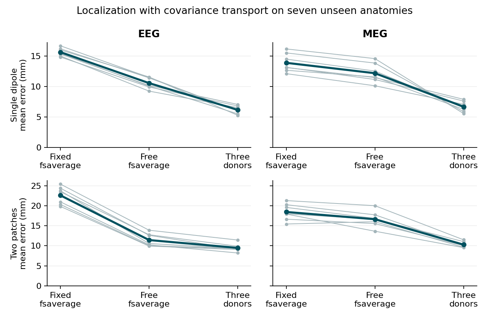

# Leadfield adaptation across head geometries

On this benchmark the old ceiling was largely a head-position problem. Rebuilding the same fsaverage forward at the three donors' mean pose recovered about three quarters of the two-source gain over transported free fsaverage. The remaining gain came from using multiple anatomies. On the independent measured MEG response, registered donor fusion matched the sensor prediction of nominal fsaverage within 0.3 percentage points. Superiority on measured localization remains open.

## Results on seven separate heads

Mean anatomical localization error in millimetres, equally weighted by head. All three columns below use the same covariance transport strength. The three-donor method averages positions for isolated sources and combines forward fields for simultaneous sources.

| Signal | Fixed fsaverage | Free fsaverage | Three donors | Paired gain over free fsaverage, mm |
|---|---:|---:|---:|---:|
| EEG, single dipole at 20 dB | 15.6 | 10.6 | **6.2** | 4.38 [3.41, 5.35] |
| MEG, single dipole at 20 dB | 13.9 | 12.2 | **6.7** | 5.49 [4.00, 7.12] |
| EEG, two active neighborhoods | 22.6 | 11.4 | **9.5** | 1.95 [1.25, 2.66] |
| MEG, two active neighborhoods | 18.4 | 16.6 | **10.3** | 6.34 [5.33, 7.33] |

Every paired comparison against transported free fsaverage favored the donor method in these four conditions. Brackets give descriptive 95% percentile bootstrap intervals, resampling seven paired heads 20,000 times with seed 123. The same seven people provide both modalities. The two-source success rate (both centers within 15 mm) rose from 62.6% to 82.1% for EEG and from 38.4% to 80.8% for MEG. With the individual free forward it was 96.1% and 91.6% respectively.



### What accounts for the improvement?

- The nominal fsaverage MRI origin differed from the donor origins by 22–32 mm in head coordinates. Moving fsaverage to the mean donor pose while keeping the cortex, BEM and RT fixed reduced two-source error from 11.44 to 9.94 mm (EEG) and from 16.64 to 11.74 mm (MEG). Full donor fusion improved a further 0.45 mm (five of seven heads) and 1.44 mm (six of seven). Selecting the pose from sensor covariance gave 11.37 mm for EEG and 11.58 mm for MEG. MEG carried more usable pose information under this calibration protocol.
- With 1,024 clean calibration maps the untransported point ensemble already achieved 7.4 mm for EEG and 7.9 mm for MEG. RT brought that to 6.2 and 6.7 mm. Each single transported donor had higher mean error. With only 64 calibration maps, RT *increased* error over the same untransported ensemble by 1.0 mm for EEG and 2.2 mm for MEG.
- Free orientation alone removed 11.1 mm of the two-source EEG error with RT. This accounts for most of the gain against the fixed-normal baseline. Comparing against free orientation isolates the remaining gain.
- Transporting the fused donors individually helped relative to untransported fusion by 0.45 mm for two-source EEG and 1.63 mm for MEG. Among individual transported donors, one performed better on average than fusion in EEG (8.9 vs 9.5 mm). The three-donor model improved over each individual donor's average for MEG.
- For isolated dipoles with only 64 calibration maps, the three-donor result was 8.4 mm for EEG and 10.1 mm for MEG, compared with 12.1 and 14.6 mm for transported free fsaverage. At 5 dB with 1,024 calibration maps, the corresponding comparison was 12.9 vs 14.6 mm and 10.4 vs 15.2 mm.
- Fitting an affine correction to the cloud of estimated source positions was fragile. At 20 dB with anterior/posterior sampling bias, hemisphere-balanced correction increased free-fsaverage error from 10.5 to 18.6 mm in EEG and from 11.9 to 18.9 mm in MEG. Under uniform sampling, an improvement in anatomical coordinates could accompany worse physical head-coordinate error. Activity distribution and head geometry can both shift the fitted cloud.
- In the matched-atlas control at 20 dB (EEG, 100206), the individual fixed model localized with under 0.1 mm mean error and the transported free fit had 1.2 mm error. The extra flexibility has a cost when anatomy is already well matched.
- On the measured 40 ms response, nominal fsaverage explained 91.8% of held-out sensor energy. Unregistered donor fusion explained 53.8%. Registering donors using the nominal head-frame prior and the scalp digitization raised fusion to 91.6%. Adding evoked-window transport then reduced it to 77.4%. The individual free forward explained 92.0%. The registered fusion and nominal fsaverage peaks lay 11.5 and 7.1 mm from the earlier ESMV reference. This recording shows strong sensitivity to coregistration and provides no evidence of improved real anatomical localization.

## Experiment

Three cached HCP heads (100206, 100307 and 100408) provided donor models. Seven different heads provided test data (100610, 101006, 101107, 101309, 101915, 102109 and 102311). The inverse had access to the sensors, calibration recordings, fsaverage and the donors. Only the simulator and scorer used test anatomy. The original 16 GB HCP download was unnecessary. The seven test forward models were computed in memory from existing reduced surfaces.

All models used the same sensor ordering within a modality. EEG used 61 average-referenced channels. MEG simulations used magnetometers. Cortical grids were ico4. Transport used the existing Bures map with geodesic strength 0.8. The covariance model used fixed cortical normals, including when the resulting transport was applied to a three-component leadfield.

**Single dipoles.** Each head supplied 512 test maps and 1,024 independently located calibration maps in the standard condition. The fixed fit maximizes squared cosine similarity. The free fit estimates the best three-component dipole moment at each location. Each transported donor makes a position estimate. We average the estimates in anatomical coordinates and project onto the nearest fsaverage vertex. The physical head-coordinate readout separately averages the donor estimates in head coordinates. The point protocol also tests 5 dB noise, fourfold hemispheric or anterior/posterior sampling bias, a 40% interfering dipole and calibration with 64 events. Calibration and test sites are disjoint within every run.

**Simultaneous sources.** Two neighborhoods of five nearby vertices have independent autoregressive time courses. Centers are more than 45 mm apart, have equal sensor-space strength, and share a 64-sample window with distributed brain and sensor noise. Neighborhoods use Euclidean proximity and aligned polarities. Calibration consists of 128 independent, 32-sample windows with twelve active dipoles each and sensor noise. Inference sees the top two signal components. The scan selects two peaks separated by at least 25 mm. Error is the mean of the two distances after minimum-cost pairing. Both peaks must fall within 15 mm to count as a two-source hit. Each head supplies 128 trials per modality.

For this second problem we fuse the **forward fields**. Each donor field is optionally transported, rotated into common anatomical dipole axes, and interpolated from the four nearest donor positions onto fsaverage. We normalize each interpolated field by its RMS gain and take their arithmetic mean. The result is a three-component leadfield usable by the same scanner as a single donor. Its global amplitude is arbitrary. This experiment measures localization.

**Pose control.** A separate run keeps the fsaverage cortex and BEM fixed and recomputes its forward solution at five head poses. Candidates are the nominal transform, the three donor transforms, and their rigid mean. One condition always uses the mean. Another selects a candidate from calibration alone by trace-normalized log-covariance distance with a 0.1 eigenvalue offset. Every candidate uses the same BEM calculation. The test maps, scoring code and trial seeds match the two-source experiment.

**Measured recording.** The saved median-nerve evoked response contains one average of 37 trials, 204 planar gradiometers and 40 digitized scalp points. We predict the preselected 35–45 ms mean topography in six folds, always withholding both gradiometers at each selected coil location. All channels are available in a separate 80–300 ms window for RT calibration, and pre-stimulus samples provide channel scales. Predictive score is one minus the held-out sum of squared residuals divided by signal energy, pooled across the six folds. For the digitized condition we initialize each donor in the nominal fsaverage head frame and fit it rigidly to the scalp samples with fiducial anchors. The comparison to the earlier individual-MRI ESMV peak is a proxy. There is no independent anatomical ground truth for this recording.

## Interpretation limits

The cortical surfaces are individual. The HCP skull layers are approximate surfaces constructed from dilated segmentations. The legacy evaluator treats native AC-PC coordinates as approximately MNI with an identity transform. Millimetre differences here measure distance in that convention, with additional uncertainty from anatomical correspondence. HCP donor and target models share the same scalp-landmark extraction and sensor conventions. The real recording uses a different acquisition and head pose. Its baseline is an evoked average and the late evoked window is a different calibration signal from the simulation's broad cortical activity.

The target heads were reused across ablations during exploratory research. The three pilot heads are excluded from replication averages. Subjects are the unit of replication. Increasing trials per subject makes the within-subject comparison more precise. Independent recordings and independently registered cohorts would answer the population-generalization question.

## Reproduction

Run from the repository root using the research environment. Set the paths below to the existing project data. Scripts accept paths explicitly and perform no dataset downloads. The JSON files contain per-head means and tail metrics. The scripts overwrite their requested output files.

```sh
PY=.venv/bin/python
S=scripts/riemannian_transport
OUT="$S/spatial_calibration"
HCP=../papers/riemannian-transport/subjects
FS=.mne_config/mne_data/MNE-fsaverage-data
EVOKED=../results/dev/somato_sweep/20260302_104408/prepared
export OPENBLAS_NUM_THREADS=1 VECLIB_MAXIMUM_THREADS=1
"$PY" "$S/eval_spatial_calibration.py" "$HCP" "$FS" "$OUT/replication.json" --confirm --controls
"$PY" "$S/eval_spatial_calibration.py" "$HCP" "$FS" "$OUT/atlas_specificity.json" --atlas 100206
"$PY" "$S/eval_atlas_gain_fusion.py" "$HCP" "$FS" "$OUT/patch_pilot.json"
"$PY" "$S/eval_atlas_gain_fusion.py" "$HCP" "$FS" "$OUT/patch_replication.json" --confirm
"$PY" "$S/eval_pose_dictionary.py" "$HCP" "$FS" "$OUT/pose_control.json"
"$PY" "$S/eval_somato_gain_fusion.py" "$HCP" "$FS" "$EVOKED" "$OUT/somato.json"
"$PY" "$OUT/plot_replication.py"
```

Environment used for these results included Python 3.13.2, MNE 1.11.0, NumPy 2.4.1, SciPy 1.17.0 and NiBabel 5.3.3.
